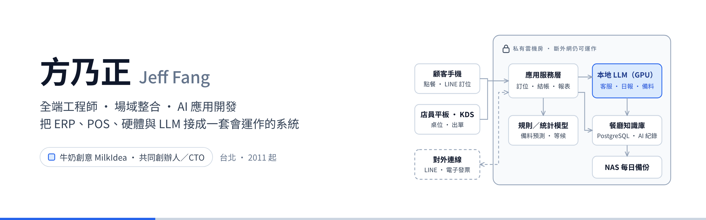

<h1 align="center">方乃正 Jeff Fang</h1>

全端工程師 · 場域整合 · AI 應用開發 
牛奶創意 MilkIdea 共同創辦人／CTO · 台北

  
  
  

15 年餐飲、零售、設施管理的場域整合經驗：把 ERP、POS、硬體與會員系統接成一套會運作的東西。2021 年起把 LLM 用進客服、自動化與資料分析；2026 年 AI Coding 全面導入後，單年 3,100+ commits、59 個專案。

### 現在在做的

- 🍽️ **AI 智慧餐廳營運平台**：訂位、候位、POS 與 LINE AI 客服，可 100% 私有雲部署（地端 Gemma）
- 🏙️ **都市更新計畫書 AI 生成與審查**：依 111 年版規則自動審查事業計畫書（POC 公開在 [webapp-city-reframe-audition](https://github.com/jeff5242/webapp-city-reframe-audition)）
- 🌾 **稻米產業 ERP × IoT**：烘乾機 Modbus 監控、流量計監測、精饌米獎票數追蹤
- 🤖 **Claude Code 多代理工作流**：企業 AI 作業系統，知識庫驅動的開發與營運自動化

### 技術

### 精選案例

| 年份 | 案例 | 做了什麼 |
|---|---|---|
| 2026 | 都市更新審查自動化 POC | 計畫書依法規逐條審查，審查意見自動生成 |
| 2026 | WFH 出勤管理 × AI 關懷訊息 | 混合辦公打卡、異常提醒、每日 AI 關懷推播 |
| 2024 | 傳統製造業 AI 轉型（精誠資訊） | AI 產線數位轉型、CDU 散熱監管 |
| 2023 | YAMAHA 山葉機車 CRM App | 會員、保養提醒與門市整合 |
| 2021– | Nuwa AI 家教 SaaS | 第一個 LLM 產品，口說評量與個人化教學 |
| 2018 | 玉山證券數位開戶、第一銀行福利網 | 金融系統交付 |

### 數字

  <picture>
    <source media="(prefers-color-scheme: dark)" srcset="https://github-readme-stats.vercel.app/api?username=jeff5242&show_icons=true&count_private=true&hide_border=true&hide_rank=true&locale=zh-tw&theme=github_dark&bg_color=00000000">
    
  </picture>
  <picture>
    <source media="(prefers-color-scheme: dark)" srcset="https://github-readme-stats.vercel.app/api/top-langs/?username=jeff5242&layout=compact&hide_border=true&langs_count=8&locale=zh-tw&custom_title=%E6%9C%80%E5%B8%B8%E4%BD%BF%E7%94%A8%E7%9A%84%E8%AA%9E%E8%A8%80&theme=github_dark&bg_color=00000000">
    
  </picture>

  <picture>
    <source media="(prefers-color-scheme: dark)" srcset="https://streak-stats.demolab.com?user=jeff5242&hide_border=true&locale=zh_Hant&theme=github-dark-blue&background=00000000">
    
  </picture>

> 本地 Git 總計 7,900+ commits、80+ repos（2011 起）；GitHub 上只看得到推上來的部分。

### 聯絡

📞 0936-923-912 · ✉️ jeff@milkidea.com · 🏢 台北市中正區忠孝西路一段 45 號 9 樓之 5
首次諮詢 30 分鐘免費：<https://www.milkidea.com/jeff#contact>
